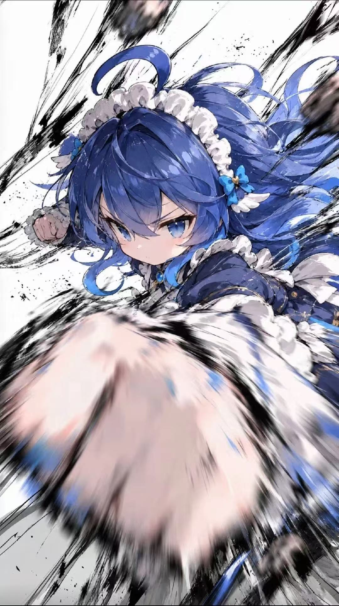

<p align="center">
  <a href="docs/fat-fish-cover.jpg"></a>
</p>

# Fish Rim · 大肥鱼出击

一款为 **DeepSeek Harness Desktop** 制作的交互式开屏。

> *Fat Fish, ready to fight.*

**版本 2.0.4**　·　Windows　·　适配 DeepSeek Harness Desktop **0.2.1-rc.2**

## 第一次进入机库

| 画面 | 你的操作 | 接下来 |
| --- | --- | --- |
| 白色下巴与蓝色蝴蝶结进入近景 | 点击 **HEAD DOCK** 或按 **H** | 颈圈承重，锁销咬合，机体上电 |
| 肥鱼背对镜头，舱门仍然关闭 | 点击 **BAY LAUNCH** 或按 **L** | 舱门开启，载台前移，进入门外亮相 |
| 女声说完最后一句 | 自动收尾 | 上下遮板在约 **1.5 秒**内合拢并交还 DSH |

两个关口各等 **4 秒**，期间可以提前确认。想直接进入工作区，随时按 **Esc**。每次完整重启客户端播放一次，切换聊天或重新聚焦窗口沿用当前进度。

## Windows 安装

**[下载 Fish Rim 2.0.4 Windows 完整安装包](https://github.com/Asuka-omo/Fish-Rim/releases/download/v2.0.4/Fish-Rim-2.0.4-Windows.zip)**

安装包内附影片、音轨和安装脚本，解压后即可离线安装。开发者可以下载仓库源码，并按下方说明导入素材后构建。[发布页与校验文件](https://github.com/Asuka-omo/Fish-Rim/releases/tag/v2.0.4)

1. 至少启动过一次 DSH Desktop，然后从 **应用 → 退出** 完全关闭客户端。
2. 将 Windows 安装包完整解压到同一文件夹，双击 **Install.cmd**。
3. 看到安装成功后正常启动 DSH，机库画面会直接出现。

安装器调用 DSH 自带的插件管理器，核对安装包和已安装文件的 SHA-256，并把运行所需的包缓存到用户目录。安装入口适用于默认 Windows 安装位置。若使用自定义安装位置，可用该安装目录内的 DSH CLI 安装随包的 TGZ，并将 TGZ 保存在固定路径。

| 维护操作 | 完全退出 DSH 后运行 |
| --- | --- |
| 回到本安装器替换前的本地版本 | **Restore.cmd**。如果原先没有该插件，则恢复为未安装状态 |
| 移除当前 Fat Fish 开屏 | **Uninstall.cmd** |

## 从源码构建

需要 Node.js 20+、npm 和 Python 3。先从 Windows 安装包中解压 `fat-fish-deployment-protocol-2.0.4.tgz`，再在仓库根目录运行以下命令。请把示例路径换成实际解压位置。

```powershell
npm ci
python scripts/import-media.py "D:\Downloads\fat-fish-deployment-protocol-2.0.4.tgz"
npm run build
npm pack
```

`src/` 包含播放流程、声音和控制台绘制；`plugin/` 与 `client/` 负责 DSH 注入、退出和交还；`public/` 是机库页面；`release-kit/` 保存 Windows 安装与恢复脚本。要验证手动确认、超时和闭幕流程，可在构建后运行 `npx playwright install chromium` 和 `npm test`。测试使用独立浏览器窗口。

## 灵感来源

感谢 UP 主 **迦勒底驻场医生罗曼尼**。这款开屏的角色与机库出动演出受到这部作品的启发。[《危险肥鱼号》 · 哔哩哔哩](https://www.bilibili.com/video/BV1CFxw63EMz/?spm_id_from=333.1391.0.0)

原创代码采用 MIT 许可。视频、角色美术、音乐与音效的来源和许可范围见[素材说明](docs/CREDITS.md)。
